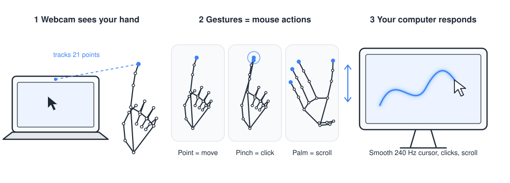

# AirMouse 🖐️

Control your computer with hand gestures. Just a webcam and [MediaPipe Hands](https://ai.google.dev/edge/mediapipe/solutions/vision/hand_landmarker).



## How it works

1. **The webcam sees your hand.** MediaPipe tracks 21 points on it.
2. **Gestures become mouse actions.** Point to move, pinch to click, open your palm to scroll.
3. **Triple-tap <kbd>Ctrl</kbd> to turn it on or off.** It runs quietly in the background.

Works on Windows, macOS and Linux. Needs Python 3.10+.

## Run it

```
git clone https://github.com/yeszhannnn/airmouse.git
cd airmouse
python3 install.py
```

Then triple-tap <kbd>Ctrl</kbd>. On Windows, run `python install.py`.

## Controls

| Gesture / key | Action |
|---|---|
| ☝️ Point | Move the cursor |
| 👌 Pinch | Click. Twice = double click, hold = drag |
| ✌️ Two fingers + pinch | Right click |
| 🖐️ Open palm, move up/down | Scroll |
| ✊ Fist | Let go of the cursor |
| <kbd>Ctrl</kbd> ×3 | On / off |
| <kbd>Ctrl</kbd>+<kbd>Alt</kbd>+<kbd>V</kbd> | Show / hide the camera |

Tweak it by putting flags like `--speed 1.3` in `~/.airmouse/args.txt` (all options: `airmouse.py --help`). Remove it with `python3 install.py --uninstall`.
